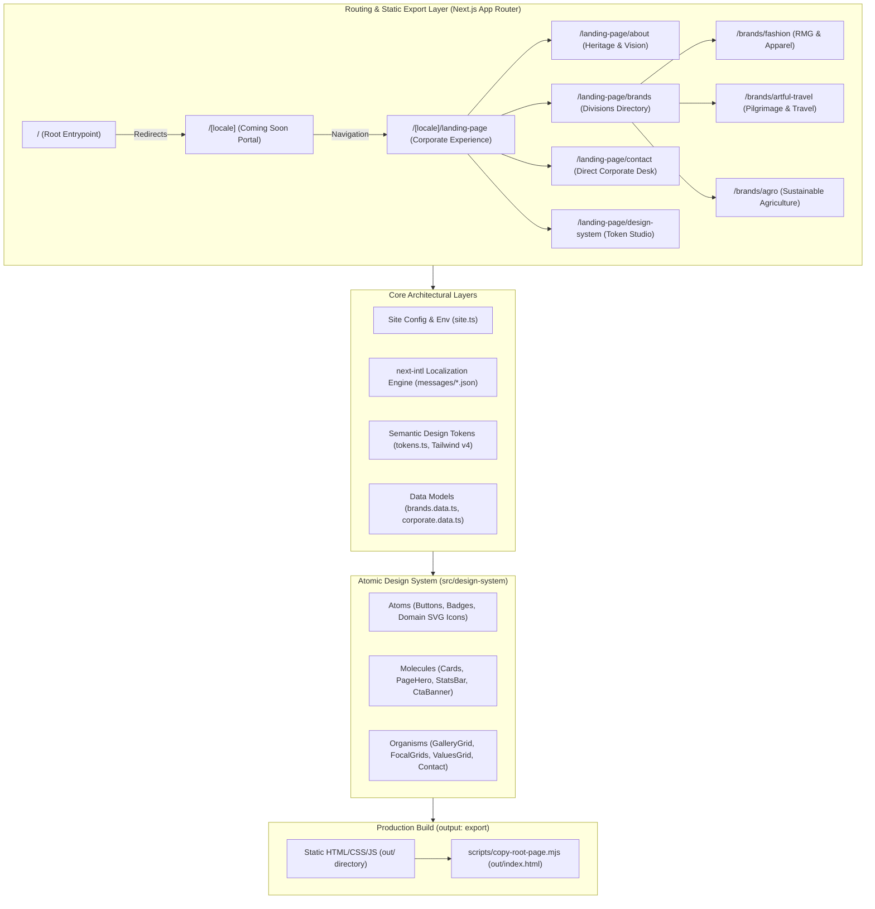

# AL Araf Group — Corporate Web Platform & Multi-Brand Showcase

An enterprise-grade, high-performance web platform and digital portfolio for **AL Araf Group**, a diversified Bangladeshi conglomerate operating across **Ready-Made Garments (RMG) & apparel sourcing**, **travel & pilgrimage logistics**, and **sustainable commercial agriculture**.

Engineered with **Next.js 16** (App Router), **React 19**, **Tailwind CSS v4**, and an **Atomic Design System**, this repository powers both a localized **Coming Soon Teaser Portal** and a comprehensive **Multi-Brand Corporate Showcase**, fully compiled into production-ready static assets via Next.js Static HTML Export (`output: "export"`).

---

## Application at a Glance

| Dimension | Details |
| :--- | :--- |
| **Application Name** | AL Araf Group Corporate Portal (`nextjs-template`) |
| **Repository** | `md-al-mamun-dev/alarafgroup-comming-soon` |
| **Application Type** | Multi-Page Corporate Portal, Teaser Landing & Static Site Export |
| **Target Audience** | International apparel retail buyers, corporate travel clients, pilgrimage travelers, bulk agricultural partners, and global commercial stakeholders |
| **Primary Framework** | [Next.js 16.4.5](https://nextjs.org) (App Router, Static HTML Export) + [React 19.3.1](https://react.dev) |
| **Language & Tooling** | [TypeScript 7.0.2](https://www.typescriptlang.org) & [pnpm 11.9.0](https://pnpm.io) |
| **Styling & Tokens** | [Tailwind CSS v4](https://tailwindcss.com) + PostCSS + Decoupled Semantic CSS Tokens |
| **Internationalization** | [next-intl 4.14.9](https://next-intl.dev) (English primary with Bengali support and dynamic typography switching) |
| **Component System** | Decoupled Atomic Design Hierarchy (`atoms/`, `molecules/`, `organisms/`, `data/`) |
| **Interactive Tools** | Live in-app Design System & Token Studio at `/[locale]/landing-page/design-system/` |
| **Deployment Target** | Static Site Hosting (Cloudflare Pages, Vercel, Netlify, AWS S3/CloudFront, Nginx) |

---

## Key Features & Functional Modules

### 1. Dual-Experience Architecture
- **Coming Soon Teaser Portal (`/[locale]`)**:
  - Islamic geometric background pattern with theme canvas.
  - Corporate brand vision, value pillars, and commercial interest previews.
  - Interactive newsletter subscription / waitlist form interface.
  - Target launch countdown integration via `NEXT_PUBLIC_LAUNCH_DATE`.
- **Full Corporate Showcase (`/[locale]/landing-page/`)**:
  - Right-focused executive hero canvas with dynamic badge labels and dual CTA routing.
  - Company overview, heritage narrative, and high-impact stats ribbon.
  - Three-brand focal showcase with 3D perspective hover cards and sibling focus shifts.

### 2. Operating Business Divisions
- **Al-Araf Fashion (`/[locale]/landing-page/brands/fashion/`)**:
  - Full-spectrum apparel manufacturing and export hub.
  - Detailed service breakdowns: Knitwear, Woven Garments, Denim, and Kids Apparel.
  - Production workflow pipeline: Design & Tech Pack $\to$ Sample Development $\to$ Mass Production $\to$ Pre-Shipment QA.
  - Interactive manufacturing gallery featuring 8 curated factory frames with smooth hover zoom and gradient scrims.
- **Artful Travel International (`/[locale]/landing-page/brands/artful-travel/`)**:
  - Premium religious pilgrimage (Hajj & Umrah) with dedicated ground logistics and holy site lodging.
  - Corporate travel management, customized international tourism packages, instant flight ticketing, and embassy work-visa processing.
  - Structured 4-step traveler journey: Consultation $\to$ Documentation $\to$ Processing $\to$ Travel Support.
- **Al-Araf Agro (`/[locale]/landing-page/brands/agro/`)**:
  - Sustainable farm management, contract farming, and post-harvest preservation.
  - Agricultural commodities: Direct-from-farm fresh produce, high-grade staple crops (aromatic rice, milling wheat, maize, pulses), and poultry/dairy supply.
  - Operational gallery highlighting cold storage facilities, smart irrigation, and grain terminals.

### 3. Corporate Heritage & Direct Desk
- **About Us (`/[locale]/landing-page/about/`)**:
  - Executive story, founding principles, and ISO 9001 governance badges.
  - Dual-card Purpose & Vision showcase with perspective tilt effects.
- **Contact Desk (`/[locale]/landing-page/contact/`)**:
  - Direct message form with localized inputs and validation.
  - Headquarters map coordinates, hotline routing, and WhatsApp instant messaging link.

### 4. Interactive Design System & Token Studio (`/[locale]/landing-page/design-system/`)
- In-browser live playground demonstrating design token primitives.
- Real-time token manipulation for colors (Warm Forest palette), typography scales, button radii, and component metrics.
- One-click production CSS variable copying for design-to-code consistency.

### 5. Internationalization (i18n) & Dynamic Typography
- Powered by `next-intl` with dictionary-based locale routing (`en` and `bn`).
- Automatic locale-based typography switching:
  - **English**: Clarity City / Manrope / Inter via Google Fonts and Fontshare.
  - **Bengali**: Noto Serif Bengali (headings) and Anek Bangla (body).

### 6. Enterprise Metadata & SEO Architecture
- Dynamic metadata generation via `app/[locale]/layout.tsx`.
- Schema.org JSON-LD `Organization` structured data with verified contact points and social profiles.
- Automated static `sitemap.xml` and `robots.txt` generation.

---

## Technology Stack

```
Frontend Architecture
├── Framework: Next.js 16.4.5 (App Router, Static HTML Export)
├── UI Library: React 19.3.1 & React DOM 19.3.1
├── Styling: Tailwind CSS v4 (@tailwindcss/postcss) + PostCSS
├── Typography: Google Fonts (Inter, Manrope, Anek Bangla, Noto Serif Bengali),
│               Fontshare (General Sans), Clarity City CDN
├── Icons: Lucide React 1.52.0 + Bespoke Domain SVGs (Kaaba, Panjabi, Suit & Tie)
├── Localization: next-intl 4.14.9
├── Validation: Zod 4.6.5
├── Language: TypeScript 7.0.2
└── Package Manager: pnpm 11.9.0
```

### Stack Breakdown

| Layer | Technology | Version | Purpose |
| :--- | :--- | :--- | :--- |
| **Runtime & Language** | TypeScript | `7.0.2` | Strict compile-time type safety across all interfaces and data models |
| **Package Manager** | pnpm | `11.9.0` | Fast, deterministic dependency management with workspace lockfile |
| **Web Framework** | Next.js | `16.4.5` | App Router, static generation, metadata engine, and image optimizations |
| **Rendering Engine** | React | `19.3.1` | Concurrent mode Server Components and interactive client primitives |
| **Styling & Theming** | Tailwind CSS | `^4.0` | Utility-first CSS with CSS theme variables and zero-runtime CSS |
| **Icons & Visuals** | Lucide React | `^1.52.0` | Crisp vector icons paired with hand-crafted Islamic/Apparel SVG atoms |
| **Localization (i18n)**| next-intl | `^4.14.9` | Request-based message loading, localized routes, and fallback handling |
| **Testing & QA** | Playwright | `^1.64.0` | End-to-end testing, visual regression screenshots, and font checks |
| **Build Automation** | Node Scripts | ES Modules | Translation key parity auditor and static root index redirector |
| **Threat Triage** | Python Scanner | Custom v3 | Supply-chain integrity, hidden code triage, and static asset auditor |

---

## System Architecture

The application adopts a **Decoupled Atomic Design Architecture** integrated with the Next.js App Router and static compilation:



---

## Project Structure

```
Agency-app/
├── app/                                 # Next.js App Router Layer
│   ├── [locale]/                        # Localized route segment
│   │   ├── layout.tsx                   # Localized root layout (HTML lang, fonts, JSON-LD)
│   │   ├── page.tsx                     # Coming Soon teaser portal
│   │   └── landing-page/                # Full corporate website experience
│   │       ├── layout.tsx               # Landing layout with Clarity City font injection
│   │       ├── page.tsx                 # Corporate landing overview
│   │       ├── about/page.tsx           # Corporate heritage, legacy, and vision
│   │       ├── contact/page.tsx         # Direct corporate inquiry desk
│   │       ├── design-system/page.tsx   # Interactive design system & token playground
│   │       └── brands/                  # Operating brand hubs
│   │           ├── page.tsx             # Multi-brand portfolio directory
│   │           ├── fashion/page.tsx     # Al-Araf Fashion division
│   │           ├── artful-travel/page.tsx # Artful Travel International division
│   │           └── agro/page.tsx        # Al-Araf Agro division
│   ├── globals.css                      # Tailwind CSS v4, theme variables & typography
│   ├── icon.svg                         # Vector favicon
│   ├── layout.tsx                       # Root pass-through layout
│   ├── page.tsx                         # Root redirect to default locale (/en)
│   ├── robots.ts                        # Search engine crawling rules
│   └── sitemap.ts                       # Dynamic sitemap generator
│
├── messages/                            # Localization dictionaries
│   ├── en.json                          # English translations
│   └── bn.json                          # Bengali translations
│
├── public/                              # Static public assets
│   ├── images/landing/                  # High-resolution brand and corporate photography
│   ├── icon.svg                         # Favicon source
│   └── robots.txt / sitemap.xml         # Generated crawler manifests
│
├── scripts/                             # Project automation & validation tooling
│   ├── check-translations.mjs           # Recursive JSON key-parity validator
│   ├── copy-root-page.mjs               # Post-build root redirect syncer for static export
│   └── verify-button.mjs                # Design token & button verification runner
│
├── src/                                 # Application Source Code
│   ├── components/                      # Shared UI components
│   │   ├── landing/                     # Corporate header and footer chrome
│   │   ├── layout/                      # Coming Soon site chrome
│   │   ├── patterns/                    # Geometric background patterns
│   │   └── ui/                          # Language switcher and utility elements
│   ├── config/                          # Central configuration
│   │   └── site.ts                      # Strongly typed site config and environment values
│   ├── design-system/                   # Decoupled Atomic Component System
│   │   ├── atoms/                       # Base primitives (Buttons, Badges, Breadcrumb, Icons)
│   │   ├── molecules/                   # Composite components (Cards, Banners, PageHero)
│   │   ├── organisms/                   # Full sections (GalleryGrid, ValuesGrid, Contact)
│   │   ├── data/                        # Static data models (brands.data.ts, corporate.data.ts)
│   │   ├── tokens.ts                    # Semantic design tokens (Warm Forest palette)
│   │   └── index.ts                     # Public design-system exports
│   ├── i18n/                            # Internationalization configuration
│   │   ├── routing.ts                   # next-intl route definitions and navigation helpers
│   │   └── request.ts                   # Server-side request locale resolver
│   └── lib/                             # Core utilities
│       └── utils.ts                     # Tailwind class merging (clsx + twMerge)
│
├── tests/                               # Test suite
│   ├── typography.spec.ts               # Playwright cross-locale typography & font test
│   └── screenshots/                     # Visual regression screenshot captures
│
├── .env.example                         # Documented environment variable template
├── next.config.ts                       # Next.js configuration (static export, allowedDevOrigins)
├── package.json                         # Dependencies and lifecycle scripts
├── pnpm-lock.yaml                       # Pinned dependency lockfile
├── pnpm-workspace.yaml                  # pnpm build approval definitions
├── security-scanner-v3.py               # Repository threat and supply chain triage scanner
└── tsconfig.json                        # Strict TypeScript compiler options
```

---

## Data Layer & State Management

### 1. Static Domain Models
The application currently operates as a fully static, zero-runtime-database deployment. All operational content is typed and organized under [`src/design-system/data/`](file:///Users/md.golamsarwer/Downloads/projects/Agency-app/src/design-system/data):
- **`brands.data.ts`**: Complete structured profiles for the three operating divisions (offerings, value propositions, manufacturing stages, and curated gallery media).
- **`corporate.data.ts`**: Value pillars, core governance principles, headquarters contact coordinates, and social media links.
- **`site.ts`**: Dynamic environment configuration wrapper with fallback values.

### 2. Planned Database Integration (Reserved)
The environment configuration includes reserved definitions for future dynamic services:
- **Database Engine**: PostgreSQL (configured via `DATABASE_URL`).
- **Use Case**: Lead intake, dynamic contact submissions, and newsletter waitlist collection.
- **Status**: *Planned / Environment Reserved*. The current release compiles statically into pure HTML/CSS/JS without requiring an active database connection.

---

## Prerequisites

Before setting up the project, ensure your workstation has the following installed:

1. **Node.js**: `v20.x` or `v26.x` (verified with `v26.13.0`).
2. **pnpm**: `v11.9.0` (mandated by `package.json`).
   - If `pnpm` is not globally installed:
     ```bash
     npm install -g pnpm@11.9.0
     # or via Homebrew:
     brew install pnpm
     ```

---

## Installation and Setup

### 1. Clone the Repository
```bash
git clone git@github.com-official:md-al-mamun-dev/alarafgroup-comming-soon.git
cd alarafgroup-comming-soon
```

### 2. Configure Environment Variables
Copy the template configuration file:
```bash
cp .env.example .env.local
```

### 3. Install Dependencies
Install exact pinned dependencies using `pnpm`:
```bash
pnpm install
```

---

## Environment Configuration

All environment variables used by the application are defined in [`.env.example`](file:///Users/md.golamsarwer/Downloads/projects/Agency-app/.env.example) and mapped through [`src/config/site.ts`](file:///Users/md.golamsarwer/Downloads/projects/Agency-app/src/config/site.ts):

| Variable | Required | Purpose | Default / Example Value |
| :--- | :---: | :--- | :--- |
| `NEXT_PUBLIC_APP_URL` | **Yes** | Canonical website URL for OpenGraph, sitemap, and JSON-LD schema | `https://alarafgroup.com` |
| `NEXT_PUBLIC_CONTACT_EMAIL` | **Yes** | Primary corporate email address for inquiries and schema metadata | `contact@alarafgroup.com` |
| `NEXT_PUBLIC_CONTACT_PHONE` | No | Primary telephone number displayed across header/footer | `+880 1234 567890` |
| `NEXT_PUBLIC_CONTACT_WHATSAPP` | No | Direct WhatsApp instant contact number | `+880 1234 567890` |
| `NEXT_PUBLIC_SOCIAL_LINKEDIN` | No | Official corporate LinkedIn profile URL | `https://linkedin.com/company/alarafgroup` |
| `NEXT_PUBLIC_SOCIAL_FACEBOOK` | No | Official corporate Facebook page URL | `https://facebook.com/alarafgroup` |
| `NEXT_PUBLIC_SOCIAL_INSTAGRAM`| No | Official corporate Instagram account URL | `https://instagram.com/alarafgroup` |
| `NEXT_PUBLIC_LAUNCH_DATE` | No | ISO 8601 target launch date for Coming Soon countdown | `2026-12-31T00:00:00Z` |
| `DATABASE_URL` | *Planned* | PostgreSQL connection string for future dynamic waitlist | *(Commented out in `.env.example`)* |
| `EMAIL_API_KEY` | *Planned* | Transactional email provider key (Resend / Brevo) | *(Commented out in `.env.example`)* |

> [!NOTE]
> Never commit `.env.local` or any private credentials to the repository. All `NEXT_PUBLIC_*` variables are embedded into client bundles at build time.

---

## Running the Application

### Development Mode
Start the local Next.js development server with Turbopack:
```bash
pnpm dev
```
Open [http://localhost:3000](http://localhost:3000) in your browser.

- Coming Soon Teaser: [http://localhost:3000/en](http://localhost:3000/en)
- Full Corporate Experience: [http://localhost:3000/en/landing-page/](http://localhost:3000/en/landing-page/)
- Fashion Brand Hub: [http://localhost:3000/en/landing-page/brands/fashion/](http://localhost:3000/en/landing-page/brands/fashion/)
- Travel Brand Hub: [http://localhost:3000/en/landing-page/brands/artful-travel/](http://localhost:3000/en/landing-page/brands/artful-travel/)
- Agro Brand Hub: [http://localhost:3000/en/landing-page/brands/agro/](http://localhost:3000/en/landing-page/brands/agro/)
- Design System Playground: [http://localhost:3000/en/landing-page/design-system/](http://localhost:3000/en/landing-page/design-system/)

### Production Static Export Build
Compile and bundle the application into static HTML, CSS, and JavaScript:
```bash
pnpm build
```
This script executes:
1. `next build --webpack`: Compiles all localized routes into `./out/`.
2. `node scripts/copy-root-page.mjs`: Copies `./out/en/index.html` to `./out/index.html` to guarantee instant root access on static web servers.

### Serving the Production Export Locally
You can preview the generated `./out/` directory using any local static file server:
```bash
npx serve out
```
Or start via Next.js:
```bash
pnpm start
```

---

## Testing & Code Quality

The repository includes a multi-layered verification pipeline:

| Command | Tool | Purpose |
| :--- | :--- | :--- |
| `pnpm test` (or `pnpm test:translations`) | Node.js | Validates recursive key synchronization and structure parity between `messages/en.json` and `messages/bn.json` |
| `npx tsc --noEmit` | TypeScript | Strict compile-time typecheck across all components, data stores, and layouts |
| `npx playwright test` | Playwright | Executes cross-browser typography validation and visual regression captures |
| `python3 security-scanner-v3.py .` | Python 3 | Scans repository for hidden payloads, disguise assets, and supply-chain vulnerabilities |
| `node scripts/verify-button.mjs` | Node.js | Automated regression validator for atomic design buttons and token parity |

---

## Static Export & Deployment

Because this project utilizes `output: "export"` in [`next.config.ts`](file:///Users/md.golamsarwer/Downloads/projects/Agency-app/next.config.ts), it generates a zero-dependency static folder in `./out/`.

### Deployment Checklist
1. Set the build command to:
   ```bash
   pnpm build
   ```
2. Set the publish/output directory to:
   ```bash
   out
   ```
3. Configure environment variables (`NEXT_PUBLIC_APP_URL`, etc.) in your hosting provider's dashboard.

### Compatible Hosting Platforms
- **Cloudflare Pages**: Direct GitHub integration with automatic preview deployments.
- **Vercel**: Deploy with static build configuration.
- **Netlify**: Deploy using `publish = "out"`.
- **AWS S3 + CloudFront**: Sync `./out/` to an S3 bucket with CloudFront CDN distribution.
- **Nginx / Apache**: Host directly from the web root directory.

---

## Security Overview

The repository follows enterprise security standards:
- **Zero Exposed Server Secrets**: All client variables are strictly prefixed with `NEXT_PUBLIC_`.
- **Supply Chain Protection**: Approved native build binaries are locked in `pnpm-workspace.yaml` (`@parcel/watcher`, `@swc/core`).
- **Automated Security Scanner**: Includes [`security-scanner-v3.py`](file:///Users/md.golamsarwer/Downloads/projects/Agency-app/security-scanner-v3.py), an in-house triage engine designed to audit against disguised binaries, trojanized npm lifecycle hooks, and unpinned actions.

---

## Troubleshooting

### 1. `zsh: command not found: pnpm`
In modern Node.js installations (v20+), `corepack` may not be activated by default.
**Solution**:
```bash
npm install -g pnpm@11.9.0
```

### 2. Upstream ESLint Warning with TypeScript 7
Running `pnpm lint` may report an upstream notice regarding `typescript-eslint`'s experimental state with TypeScript 7.
**Solution**: Use `npx tsc --noEmit` as the definitive typecheck source of truth for CI/CD pipelines.

### 3. Static Export Trailing Slashes
The project is configured with `trailingSlash: true` in `next.config.ts` to ensure compatibility with static file systems and S3-based web servers. Always ensure links reference directory paths (e.g., `/landing-page/contact/`).

---

## License & Maintainers

- **Proprietary**: Copyright &copy; 2026 **AL Araf Group**. All rights reserved.
- **Maintainer**: AL Araf Group Engineering & Digital Strategy Desk.
